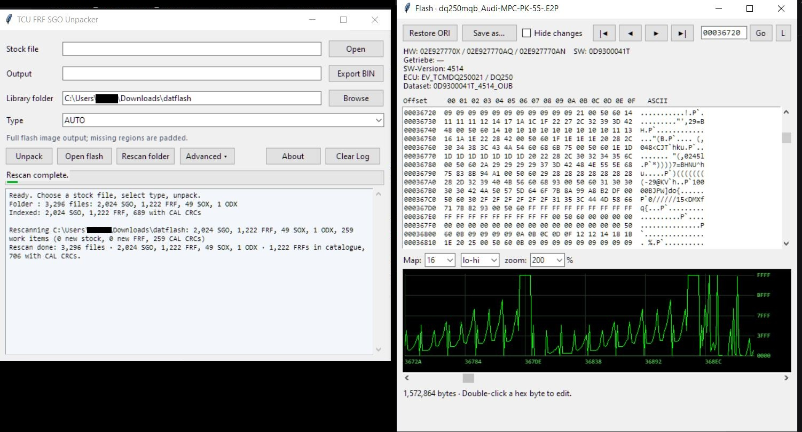

# TCU FRF / SGO Unpacker

Windows GUI for VAG transmission update files: DQ200, DQ250, DQ381, DQ400e,
DQ500, DL382, DL501, AL55x,95x,1000

**Unpack** - open a factory `.frf` / `.odx` / `.sgo` and get the complete stock
flash image.

**Restore** - open a tuned dump, press `Restore ORI`, pick the closest stock
file from your library and apply only the calibration bytes you tick.
Application and boot areas, SW markings and per-TCU checksum cells are never
written; the result is saved as a new file with a change report.

A hex editor, an ORI/MOD comparison (`Hide changes`) and a 2D value plot are
built in.

## Run

`dist/TCU SGO FRF Unpacker.exe` - no installation required. Point it at a folder
of stock files and press `Rescan folder` once; the index is kept as
`catalogue.json` in that folder.

## Build

```powershell
pip install -r requirements.txt
powershell -ExecutionPolicy Bypass -File build_gui.ps1
```

Built and shipped with **Python 3.14.3** (MSC v.1944, 64-bit) and **MSVC
19.44.35225 for x64** (Visual Studio 2022 17.14) for `sgo_fast.dll`; the exact
versions are listed in `requirements.txt`. `build_gui.ps1` compiles the DLL
from `sgo_fast.c` and falls back to the pure-Python paths if it is missing.



## Licence

MIT - see [LICENSE](LICENSE). Third-party components and the recovered key
material are covered separately in
[THIRD_PARTY_NOTICES.md](THIRD_PARTY_NOTICES.md).

## Privacy

The application is offline: no telemetry, no network access. See
[PRIVACY.md](PRIVACY.md).

## References

- [VW_Flash](https://github.com/TheFlashBold/VW_Flash) - flashing tools and
  decompression/container reference for VAG control units; the LZSS10
  decompressor and several block layouts were ported from it (BSD-2-Clause).
- [PyCryptodome](https://www.pycryptodome.org/) - AES for the DQ381/DQ500
  containers.
- [PyInstaller](https://pyinstaller.org/) - the standalone executable.

## Thanks

Special thanks to [bri3d](https://github.com/bri3d) (Brian Ledbetter), whose
VW_Flash reverse-engineering work made the decompression and container
handling in this project possible.

Not affiliated with or endorsed by Volkswagen AG, Audi AG or any of their
suppliers; part numbers and key material are used for interoperability only.

